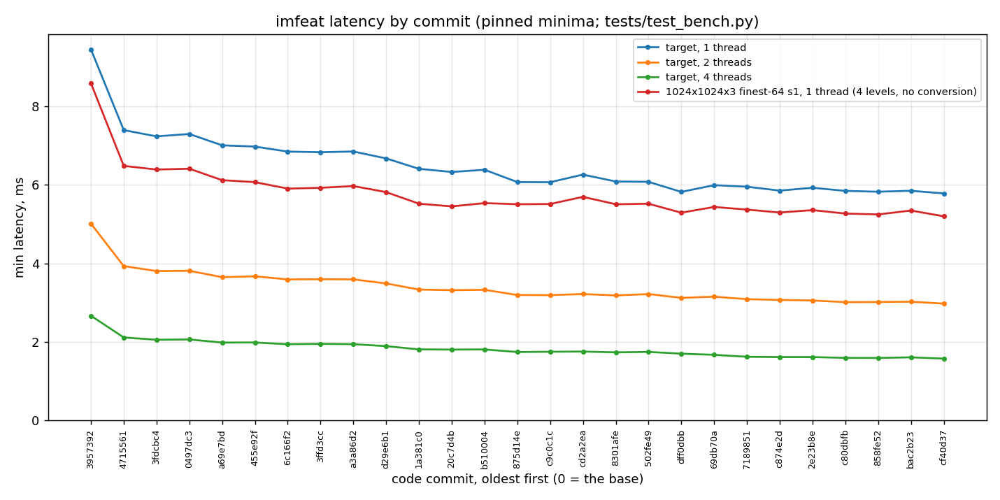

# The optimisation branch, commit by commit: a checkpoint report

This is the record of one long optimisation session on `imfeat`'s core, the branch
`claude/go-latency-optimization-d96bd1` of October 28–29, 2026: where it started, where it
ended, what every code commit bought as measured by the benchmark suite, what was tried and
dropped, and what the whole run says about where to look next. It is the companion of
[OPTIMIZATION.md](OPTIMIZATION.md), the engineering log, which has the mechanism of every
step in detail and the full history before this branch (its steps 1–9); this report is the
measured timeline and the summary of lessons. Read this one first, that one for the how.

## 1. Scope: the starting and ending commits

| | commit | date | what it is |
|---|---|---|---|
| start | `3957392` | 2026-10-28 | `main` at *Add AGENTS.md*: the code before this branch. Steps 1–9 of the engineering log are already in it. Every "original" or "base" number below is this commit |
| last code change | `cf40d37` | 2026-10-29 | step 27, *LBP ring: the neighbour test as a saturating subtract compared with zero* |
| end | the commit that adds this file (`git log -1 --format=%h -- docs/LEARNINGS.md`) | 2026-10-29 | this report, the benchmark it adds and the measurement script; no change to the core |

Between them: 26 commits that change `src/imfeat/core.cpp` (the engineering log's steps
10–27; some steps took two or three commits) and 25 commits that change only the log and the
README (every idea tried and reverted was written up in its own commit). Nothing else in the
tree changed until this checkpoint, which adds `tests/test_bench.py::test_target_pyramid`
and `scripts/latency_by_commit.py`.

The constraints held throughout: every output bit-identical to the base on the GCC/AVX2,
clang and SSE4-only builds, identical across 1 to 6 threads, no approximation, nothing tuned
to one machine (Highway's portable operations only, no per-CPU parameters). One change that
would have moved the summary's float64 moment statistics in their last bits was built,
measured and reverted (section 5); the contract stands.

## 2. How the numbers were taken

* **The suite.** `pytest -m bench -s tests/test_bench.py` of this checkpoint, run unchanged
  against each commit's build: stride and channel sweeps at 256², 512² and 1024² with 32×32
  and 64×64 finest grids, the per-channel cost, thread scaling at strides 2 and 4, the
  headline `features()` latencies, the colour conversion and the thumbnail resize alone and
  inside the pass, the thumbnail policies, and the target scenario added at this checkpoint.
  Each run prints about 1,100 numbers: some 400 latencies, each with its minimum, mean,
  standard deviation and percentiles over the timed calls. The minimum of every one of them
  is in [learnings/latency_by_commit.csv](learnings/latency_by_commit.csv), one row per
  latency and one column per commit (the commits' subjects are in `commits.txt`); the
  other statistics describe the run's noise on a shared machine, not the code, and are
  not kept. The raw logs (81 files, 3.3 MB) are not checked in either; the sweep writes
  them to `learnings/logs/`.
* **The target scenario** (`test_target_pyramid`): a 1024×1024×3 BGR frame, the fused HSV
  conversion, stride 1, the full seven-level pyramid from 64×64 cells down to 1×1, on 1, 2
  and 4 threads. The suite's other latencies use four levels and take the image as it is
  (`feature_space=None`); the target is the host's use.
* **The machine.** AMD Ryzen 7 3700X (8 cores, 16 threads, two core complexes of four cores
  with an L3 each), 64 GB of non-ECC memory, Linux 6.8, GCC 11, Highway 1.2.0 with the
  static AVX2 target, Python 3.10, numpy. The machine was shared with other people's jobs
  throughout; every run was pinned with `taskset` to idle physical cores, and the statistic
  to read is the **minimum** over the suite's 500 timed calls. On this host the minimum of a
  pinned run repeats to about ±1.5–3% between sessions, and code placement alone moves it by
  ±1.5% (lesson 13 of the log), so a step under 2% is not resolved by this table; the log's
  per-loop cycle counts were the judge for those.
* **Three runs, the minimum kept.** The suite ran twice in full over all 27 builds, pinned to
  cores 5, 6, 7 and 1 (the one busy core of each complex avoided; about 2.5 minutes a
  commit), and the target scenario alone ran a third time, pinned inside one complex (cores
  4–7) once the machine had gone quiet. The reported number is the minimum over the runs,
  the same statistic as the log's A/B/B/A method. The third run is there because the full
  runs' 2- and 4-thread lines were bimodal: a frame whose threads happened to land on both
  complexes took 3.6–3.9 ms at two threads against 3.0–3.1 with both on one, and the base
  itself read 5.6 ms against 5.0. The single-thread lines did not care. Pin inside one
  complex when the thread count allows it; this is the one machine-specific finding of the
  report, and it is a finding about measurement, not about the code.
* **The script.** `scripts/latency_by_commit.py sweep` lists the commits that touch
  `src/` or `CMakeLists.txt`, exports each with `git archive`, builds it with CMake (one
  build directory reused, so only `core.cpp` recompiles), assembles an importable package
  and runs the suite of the current checkout against it; `report` parses the logs into the
  CSV, the Markdown table and the chart. Section 7 has the commands.

## 3. The target scenario across the branch



Minimum latency in ms of the target scenario at 1, 2 and 4 threads, and of the suite's
1024×1024×3 finest-64 stride-1 headline (four levels, no conversion, one thread), at the base
and after every code commit, oldest first. Index 0 is the base. Each number is the minimum
over the three runs of section 2; the runs on their own are
[run 1](learnings/latency_by_commit_run1.md), [run 2](learnings/latency_by_commit_run2.md)
and the [single-complex target run](learnings/latency_by_commit_ccx.md). The 2- and 4-thread
rows come almost entirely from the last (25 and 27 of the 27 entries), the only run whose
threads never crossed the core complexes; the 1-thread row and the headline, which the
target run does not include, come mostly from run 2 (23 and 24 of 27), the quieter of the
two full runs.

| # | commit | target, 1 thread | target, 2 threads | target, 4 threads | headline, 1 thread | change |
|---|---|---|---|---|---|---|
| 00 | `3957392` | 9.448 | 5.011 | 2.665 | 8.585 | Add AGENTS.md |
| 01 | `4715561` | 7.392 | 3.929 | 2.113 | 6.482 | Kernel as register-resident phases; cheaper folds; signed HOG sums |
| 02 | `3fdcbc4` | 7.234 | 3.804 | 2.054 | 6.389 | Extrema from the LBP ring, nibble-counted LBP bins, two shared sums |
| 03 | `0497dc3` | 7.294 | 3.810 | 2.062 | 6.410 | Sliding plane window: every kernel tap a constant offset from the row |
| 04 | `a69e7bd` | 7.005 | 3.648 | 1.983 | 6.118 | A batch of small kernel items, kept by pinned A/B timing: -10% at stride 1 |
| 05 | `455e92f` | 6.974 | 3.670 | 1.985 | 6.068 | Batched fold for one-cell blocks: four kinds reduced together |
| 06 | `6c166f2` | 6.846 | 3.591 | 1.940 | 5.903 | Vector hash row sums; batched multi-cell folds for the HOG and pair kinds |
| 07 | `3ffd3cc` | 6.830 | 3.596 | 1.950 | 5.924 | Level 1 derived in its band from the rolled-up sums; a vector flush |
| 08 | `a3a86d2` | 6.848 | 3.592 | 1.942 | 5.968 | Split the two phases of a raw row as it is gathered |
| 09 | `d29e6b1` | 6.672 | 3.488 | 1.892 | 5.814 | Derive and roll up cells in groups of four, whatever the block width |
| 10 | `1a381c0` | 6.407 | 3.333 | 1.809 | 5.519 | Halve the HOG ray tests by the rays' mirror symmetry; bar detector sums in registers |
| 11 | `20c7d4b` | 6.327 | 3.317 | 1.804 | 5.450 | Give the bar detector phase a function of its own |
| 12 | `b510004` | 6.383 | 3.326 | 1.808 | 5.534 | Energy phase at stride 1 as three chunk-wide product sums per response column |
| 13 | `875d14e` | 6.070 | 3.194 | 1.742 | 5.506 | HSV conversion: the table step as one rounding of the float guess |
| 14 | `c9c0c1c` | 6.066 | 3.190 | 1.749 | 5.511 | Resize: the horizontal pass over all of a row's planes at once |
| 15 | `cd2a2ea` | 6.260 | 3.219 | 1.754 | 5.693 | Resize: the float taps' shuffle lands each byte in its int32 lane |
| 16 | `8301afe` | 6.084 | 3.183 | 1.734 | 5.505 | Resize: a destination row finished in one pass from its cached tap rows |
| 17 | `502fe49` | 6.076 | 3.218 | 1.745 | 5.518 | Resize: the shuffle table's window by a broadcast-128 load |
| 18 | `dff0dbb` | 5.819 | 3.121 | 1.700 | 5.290 | Roll up two kinds per lane add; fold the summary once per cell row |
| 19 | `69db70a` | 5.991 | 3.151 | 1.670 | 5.436 | Summary across threads from three bands, every fold in its cell order |
| 20 | `7189851` | 5.952 | 3.088 | 1.621 | 5.369 | Summary after the join split by lane across the threads |
| 21 | `c874e2d` | 5.852 | 3.069 | 1.614 | 5.294 | Prefetch where the frame is first read; the finish converts in range; the kinds loop decides the block width once |
| 22 | `2e23b8e` | 5.925 | 3.054 | 1.614 | 5.356 | Records prefetched ahead of the derive's stores; the resize's store bound tested once per group |
| 23 | `c80dbfb` | 5.845 | 3.012 | 1.593 | 5.268 | Cells derived and rolled up eight at a time, the group's kind stride a whole line |
| 24 | `858fe52` | 5.824 | 3.016 | 1.591 | 5.246 | Resize rounding: the saturating pack is the clamp |
| 25 | `bac2b23` | 5.848 | 3.023 | 1.607 | 5.345 | Resize: the periodic groups of the horizontal pass with their slot tables in registers |
| 26 | `cf40d37` | 5.781 | 2.975 | 1.574 | 5.198 | LBP ring: the neighbour test as a saturating subtract compared with zero |

The same, as speed-ups against the base:

| # | commit | target, 1 thread | target, 2 threads | target, 4 threads | headline, 1 thread | change |
|---|---|---|---|---|---|---|
| 00 | `3957392` | 1.00× | 1.00× | 1.00× | 1.00× | Add AGENTS.md |
| 01 | `4715561` | 1.28× | 1.28× | 1.26× | 1.32× | Kernel as register-resident phases; cheaper folds; signed HOG sums |
| 02 | `3fdcbc4` | 1.31× | 1.32× | 1.30× | 1.34× | Extrema from the LBP ring, nibble-counted LBP bins, two shared sums |
| 03 | `0497dc3` | 1.30× | 1.32× | 1.29× | 1.34× | Sliding plane window: every kernel tap a constant offset from the row |
| 04 | `a69e7bd` | 1.35× | 1.37× | 1.34× | 1.40× | A batch of small kernel items, kept by pinned A/B timing: -10% at stride 1 |
| 05 | `455e92f` | 1.35× | 1.37× | 1.34× | 1.41× | Batched fold for one-cell blocks: four kinds reduced together |
| 06 | `6c166f2` | 1.38× | 1.40× | 1.37× | 1.45× | Vector hash row sums; batched multi-cell folds for the HOG and pair kinds |
| 07 | `3ffd3cc` | 1.38× | 1.39× | 1.37× | 1.45× | Level 1 derived in its band from the rolled-up sums; a vector flush |
| 08 | `a3a86d2` | 1.38× | 1.40× | 1.37× | 1.44× | Split the two phases of a raw row as it is gathered |
| 09 | `d29e6b1` | 1.42× | 1.44× | 1.41× | 1.48× | Derive and roll up cells in groups of four, whatever the block width |
| 10 | `1a381c0` | 1.47× | 1.50× | 1.47× | 1.56× | Halve the HOG ray tests by the rays' mirror symmetry; bar detector sums in registers |
| 11 | `20c7d4b` | 1.49× | 1.51× | 1.48× | 1.58× | Give the bar detector phase a function of its own |
| 12 | `b510004` | 1.48× | 1.51× | 1.47× | 1.55× | Energy phase at stride 1 as three chunk-wide product sums per response column |
| 13 | `875d14e` | 1.56× | 1.57× | 1.53× | 1.56× | HSV conversion: the table step as one rounding of the float guess |
| 14 | `c9c0c1c` | 1.56× | 1.57× | 1.52× | 1.56× | Resize: the horizontal pass over all of a row's planes at once |
| 15 | `cd2a2ea` | 1.51× | 1.56× | 1.52× | 1.51× | Resize: the float taps' shuffle lands each byte in its int32 lane |
| 16 | `8301afe` | 1.55× | 1.57× | 1.54× | 1.56× | Resize: a destination row finished in one pass from its cached tap rows |
| 17 | `502fe49` | 1.55× | 1.56× | 1.53× | 1.56× | Resize: the shuffle table's window by a broadcast-128 load |
| 18 | `dff0dbb` | 1.62× | 1.61× | 1.57× | 1.62× | Roll up two kinds per lane add; fold the summary once per cell row |
| 19 | `69db70a` | 1.58× | 1.59× | 1.60× | 1.58× | Summary across threads from three bands, every fold in its cell order |
| 20 | `7189851` | 1.59× | 1.62× | 1.64× | 1.60× | Summary after the join split by lane across the threads |
| 21 | `c874e2d` | 1.61× | 1.63× | 1.65× | 1.62× | Prefetch where the frame is first read; the finish converts in range; the kinds loop decides the block width once |
| 22 | `2e23b8e` | 1.59× | 1.64× | 1.65× | 1.60× | Records prefetched ahead of the derive's stores; the resize's store bound tested once per group |
| 23 | `c80dbfb` | 1.62× | 1.66× | 1.67× | 1.63× | Cells derived and rolled up eight at a time, the group's kind stride a whole line |
| 24 | `858fe52` | 1.62× | 1.66× | 1.68× | 1.64× | Resize rounding: the saturating pack is the clamp |
| 25 | `bac2b23` | 1.62× | 1.66× | 1.66× | 1.61× | Resize: the periodic groups of the horizontal pass with their slot tables in registers |
| 26 | `cf40d37` | 1.63× | 1.68× | 1.69× | 1.65× | LBP ring: the neighbour test as a saturating subtract compared with zero |

## 4. What worked: the committed changes

One line per code commit, in order; the engineering log has each one's mechanism under its
step number. The effect column is the log's own measurement at the time (pinned A/B/B/A
minima, or instruction and cycle counts where the wall clock could not resolve the item);
the sweep's numbers for the same commit are in section 3 and the CSV. "The headline" in
this column is the log's: 1024×1024×3 at a 32×32 finest grid, stride 1, one thread; section
3's headline is the suite's finest-64 one.

| # | commit | step | the change | effect as measured in the log |
|---|---|---|---|---|
| 01 | `4715561` | 10 | Kernel as register-resident phases down the rows, row responses cached, HOG sums signed | 1024×1024×3 finest-32 stride 1, one thread: 7.44 → 5.42 ms (1.37×); finest-64 8.93 → 6.80 (1.31×); C=1 2.50 → 1.85 (1.35×) |
| 02 | `3fdcbc4` | 10 | From a callgrind profile: extrema from the LBP ring, nibble-counted LBP bins, two shared sums, kind-contiguous per-block cell sums, whole-vector fold reductions | part of step 10's figures above (the second half of the step) |
| 03 | `0497dc3` | 11 | Sliding contiguous plane window, affine response slots: every kernel tap a constant offset from one row pointer | instructions per frame 67.4 M → 61.8 M (−8%); wall clock within noise (the scalar work had run alongside the vector work); 8 px cells and 256² about −2% |
| 04 | `a69e7bd` | 12 | A batch of small kernel items kept by pinned A/B timing: line-aligned plane rows, zero-interleave widening, saturating bar gate, promote-based sign extension, fourth-power pair sums widened every two rows, compare-based HOG sign masks | finest-32 stride 1 5.38 → 4.84 ms (−10%); stride 2 −18%; C=1 −12%; finest-64 −5%; 512² −4%; 256² −1% |
| 05 | `455e92f` | 13 | Batched fold for one-cell blocks: four kinds reduced together into one four-lane store | finest-32 stride 1 4.72 → 4.49 ms (−5%) for the three commits of step 13 together; 64 and 128 px cells −8%; 256² −8% |
| 06 | `6c166f2` | 13 | Hash-grid row sums through `psadbw`; batched multi-cell folds for the HOG and pair kinds | 8 px cells at stride 2 −6% (the folds); 16 px cells at stride 2 −6% |
| 07 | `3ffd3cc` | 13 | Level 1 derived in its band from the rolled-up sums through `derive_block`, its slots written by a vector flush four cells at a time | 8 px cells at stride 2: −7.7% of the instructions, the time within noise with three channels and −4 to −6% with one channel or at 512² |
| 08 | `a3a86d2` | 14 | The two phases of a raw row split as it is gathered | 8 px cells at stride 2 −2.2% of the instructions (the gather) |
| 09 | `d29e6b1` | 14 | Cells derived and rolled up in groups of four whatever the block width: one- and two-cell blocks no longer go through the scalar flush and gathers | instructions per frame 63.6 M → 52.5 M (−17%) at finest-32 stride 1; wall clock within ±2% on a loaded machine (the first measurement that could not resolve a step) |
| 10 | `1a381c0` | 15 | HOG ray tests halved by the rays' mirror symmetry; the bar detector's sums passed by value through its runs | finest-32 stride 1 4.69 → 4.45 ms (−5.1%) |
| 11 | `20c7d4b` | 15 | The bar detector's phase in a function of its own, so the row loop has the registers to itself | −2.3% more at the same configuration |
| 12 | `b510004` | 15 | The energy phase at stride 1 as three chunk-wide product sums per response column with corrections once per chunk | −1.9% more; after the three commits of step 15, the original build to this one on one quiet core: 7.51 → 4.28 ms (1.75×) at finest-32 stride 1, 1 / 2 / 4 threads 7.36 / 3.74 / 1.97 → 4.21 / 2.14 / 1.15 ms |
| 13 | `875d14e` | 16 | The fused HSV conversion's table step as one rounding of the float guess (the floor-and-remainder correction proven unnecessary) | HSV frames: finest-32 stride 1 5.05 → 4.77 ms (−5.4%); 512² −4.3%; 256² −3.9%; the conversion alone 0.86 → 0.61 ms; exact on all 2²⁴ colours |
| 14 | `c9c0c1c` | 17 | The resize's horizontal pass over all of a row's planes at once: one group's tap patterns and weights for up to four planes | the gate's 1080p → 1024×576 HSV frame 7.18 → 6.84 ms (−4.7%); the resize alone −13.7% there and −22.7% at 720p → 512×320 |
| 15 | `cd2a2ea` | 17 | The float taps' shuffle lands each byte in its int32 lane, so the widening goes: four operations a tap and plane instead of five | the resize's instructions per gate frame −6.1% for the two commits of step 17 together |
| 16 | `8301afe` | 18 | The resize's finish in one pass from three cached resampled rows: tap rows summed, rounded and stored as bytes in one sweep | 1080p → 1024×576 the resize 1.98 → 1.66 ms (−16.5%); 720p → 512×320 −4.6%; the gate frame 6.59 → 6.16 ms (−6.6%) |
| 17 | `502fe49` | 18 | The shuffle table's 16-byte window duplicated by a broadcast-128 load instead of a shuffle | the resize −3% at 1080p → 1024×576 in three runs; the gate frame −0.3 to −0.7% |
| 18 | `dff0dbb` | 19 | The level-1 roll-up two kinds per even/odd lane add; the finest level's summary folded once per cell row | the gate's pass 4.09 → 3.87 ms (−5.4%); 16 px cells at 1024² −3.2%; the headline −0.2%; roll-up instructions 6.2 M → 2.7 M, summary 6.3 M → 4.3 M per two gate frames |
| 19 | `69db70a` | 20 | The summary of a multi-band frame spread over the threads from three bands, every fold in its cell order; a third job after the join | the gate's 1080p HSV frame: 3 threads 2.68 → 2.48 ms (−7.4%), 4 threads 2.14 → 1.98 (−7.5%); 1 and 2 threads unchanged |
| 20 | `7189851` | 21 | The summary after the join split by lane (a level's cells, one channel, a range of feature groups) across the threads; band 0's in-band share and the two-band serial fold go | 2 threads 2.83 → 2.77 and 2.78 → 2.71 ms (−2.1%, −2.4%); 3 and 4 threads within ±0.5% |
| 21 | `c874e2d` | 22 | Prefetch where the frame is first read; the resize's finish converts without the overflow fix-up; the kinds loop decides the block width once | together the gate −0.0% and −0.4%, two threads −0.5%, the headline −0.7%; the module's instructions per two gate frames 142.7 M → 139.5 M (−2.2%) |
| 22 | `2e23b8e` | 23 | The finest level's records prefetched two groups ahead of the derive's stores; the resize's store bound tested once per group | the scatter loop 506 → 282 cycle samples of 23,171 (−1.0% of the module); the gate −2.4%, the headline −1.1% |
| 23 | `c80dbfb` | 24 | Cells derived and rolled up eight at a time, the group's kind stride a whole cache line | the roll-up loops 553 → 370 samples of 22,472 (−0.8% of the module); the gate −1.7%, 16 px cells −1.7%, the headline −0.6% |
| 24 | `858fe52` | 25 | The resize's rounding stores through the saturating pack alone: the explicit clamp was the pack's saturation done twice | the finish loop −0.65% of the module by cycles; the gate −1.7% |
| 25 | `bac2b23` | 26 | The resize's periodic groups (where the ratio's period divides the group width) run with the slot tables in registers and the slot count a compile-time constant | the horizontal pass's loops 2565 → 1737 cycle samples (−3.7% of the module); instructions per two gate frames 135.7 M → 124.5 M (−8.3%); the gate 5.10 → 4.94 ms at one thread (−3.2%), 2.68 → 2.58 at two (−3.7%) |
| 26 | `cf40d37` | 27 | The LBP ring's eight neighbour tests as a saturating subtract compared with zero: the same mask off the two pipes the ring's minima and shuffles queue on | the LBP loop 3331 → 2966 and 3301 → 2975 cycle samples (−11%, −10%); the module −1.3% and −0.8% |

Where the time went, in the end. The six kernel loops (the LBP ring, the bar detector, the
row responses, the Gram energies, the moments and the HOG ray tests) are about four fifths
of a single-thread frame at the headline configuration, each at or within a few instructions
of what its arithmetic needs and, measured by ablation and by the core's pipe widths, within
about 20% of the issue floor of the pipes it uses. The per-cell stages (fold, derive,
scatter, roll-up, summary) are each under a few percent. With several threads the serial
tail is the summary fold after the join and two wake-ups a frame.

## 5. What did not work

Everything below was built, verified bit-exact where it got that far, measured and reverted;
each has a paragraph in the engineering log ("Looked at after step N", "Tried after step
N"). Grouped by what the attempt assumed.

**Trading instructions for pipe balance.** Once a loop is at its instruction count, moving
an operation to a less busy pipe helps only if it costs no instruction. The LBP ring's
neighbour test (step 27, −10% on that loop) was the one such swap; the HOG's sign-flips as
mask, xor and subtract (+22% on its loop), the LBP minima as subtracts (+10%), the bar
detector's maxima as subtract and add (+13%) and the LBP bin select as a max (within noise)
all cost an instruction and all lost. A build with no change measured +3% on one loop in the
same session: that is the noise of one run on one loop, so every such item needs two runs.

**Fusing phases or sharing accumulators to save loop overhead.** The extrema folded into
the bar detector's sweep (+2%, registers ran out); the extrema and LBP in one sweep (spills);
one-cell blocks' energy halves and HOG quarters sharing accumulators in one loop (GCC
interleaves the unrolled parts and spills: the HOG loop 4 × 34 → 174 instructions with 43
spill moves); the two-row HOG loop; the four-row widening of the moments; the stride-1
product sums only for chunks of sixteen rows (−2.0% then +3.1% in two timings). The phases
are separate because the register file is the limit, not the loop count.

**Caching or restructuring what the kernel reads.** HOG rays read once per block instead of
per quarter (−0.8% instructions, +1.8% time: four vectors held across the block cost the
phases around them more than the copies did); rays passed as a pointer (no change in the
generated loop); the centre response dropped from the stored set and widened from the row
bytes (+2.7%: the moments loop went 46 → 79 instructions for the addressing); the vertical
accumulation fused into the resize's horizontal pass; a doubled plane window; the
horizontal pass with its first slot peeled (the compiler had already peeled it).

**Layout changes inside `cell_row`.** The one-cell fold staged contiguous and transposed per
group (the fold's own loops −15%, but the gate +3.6%, +3.0% and +1.6% in three forms: every
form recompiled the other inlined loops larger); the derive's scatter as eight-float stores
(−0.8% gate, +1.7% headline, and worse by loop cycles once that judge existed). `cell_row`
holds every phase inlined, and a pointer kept live across its block loop changes the
register allocation of all of them, so any change inside it must be judged on every
configuration's loops, not only the target's.

**Threading mechanics.** Spin-then-park before the condition variable (−9% on a 64×64 frame
at two threads, but +1.6% and +2.2% on the gate's frame: the ceiling is about 1%, under what
the host resolves, and a spinning worker holds a core someone else is using); the summary
prefetched ahead of its fold; a build without the 21 numpy views a frame returns (0.4%: not
worth an API change). The band-independent summary (per-row partial sums folded in-band,
combined after the join) was the only lever above 1% left and the only change that would
have moved an output: −10% at two threads and −12% at four, but +2% at one thread (the extra
accumulator working set, not instructions: +0.2%), 1.75× / 1.76× / 1.91× the base at 1 / 2 /
4 threads, so under the 2× target everywhere; on 1,914 real photographs it left every map,
moment, hash and float32 feature summary bit-identical and moved only the float64 moment
summaries (means by at most 9e-13 relative, standard deviations by at most 1.5e-8).
Reverted on the rule that an output-changing change must pay across the board, the single
thread included. The log's paragraph has the design if that rule ever changes; the patch
itself was kept only in the session's scratch space, not in the repository.

**Compilers and flags.** clang 14 on the same source: +3.1% on the gate's frame, +6.2% on
the headline, +15% at 8 px cells (and it needs contraction and reciprocals turned off
globally to keep the resize exact), so GCC stays. Profile-guided optimisation, `-O2`,
`-falign-loops`: measured, within noise or worse, not taken. `|grad|⁴` through FMA:
reverted. The HSV conversion's two reciprocal variants and a two-block row: neither kept.

**Measurement itself.** Three items were accepted or rejected on wall clock alone and were
wrong by the per-loop judge; a whole-process instruction count varies by 5% between runs
through Python; an unpinned run on this host wanders by 3%; identical binaries differ by up
to 3.6% on a single loop in one run. Section 6 has what replaced these.

## 6. Trends and lessons: where to look next, and where not to

What the branch as a whole says, for whoever picks this up (the engineering log's lessons
1–13 are the per-step versions).

1. **The kernel is at its floor on this core; the remaining single-thread levers are under
   1% each.** Steps 10–15 took the kernel from 7.44 to 4.28 ms at the log's headline
   (1024×1024×3, finest-32, stride 1, one thread) by cutting
   instructions (register-resident phases, the sliding window, the HOG symmetry, spills
   removed); steps 22–27 took the remaining 5% out of the stages around it and the resize by
   per-loop cycle profiling. After step 27 every kernel loop is at its instruction count and
   within about 20% of its pipe floor, and ablations put the cost of an instruction removed
   at about 0.45 cycles: the loops are issue-bound, not latency-bound. More single-thread
   speed from this kernel means fewer operations per pixel, which the log's rejected list
   shows is not available without changing what is computed.
2. **The gains came from structure, not tuning.** The large steps were layouts and algebra:
   columns as lanes, phases that keep their accumulators in registers, the plane window with
   constant offsets, symmetry in the HOG rays, the resize's periodicity, cells derived in
   groups. Flags, compilers, PGO, alignment and prefetch distances were each worth at most
   1–2% and often nothing.
3. **The resize and the conversion were the cheapest wins per hour late in the session.**
   Steps 16–18, 25 and 26 are five of the last twelve steps and the three largest of them;
   the resize is a quarter of the gate's instructions and its loops had slack the kernel
   had not. If the hosts' frames keep arriving at 1080p, the resize is where a further few
   percent still is (the generic multi-tap path, ratios whose period does not divide the
   group width).
4. **Multi-thread frames are bounded by the serial tail, and the tail is the summary.** At
   four threads the summary fold after the join is about a tenth of the frame (a build
   without it measured −10% before step 20, the band-independent version −12% after step
   27) and is bound by cross-core reads of the per-cell features. Within the bit-exact contract it has been split
   by level (step 20) and by lane (step 21) and is at its limit; the only way to remove it
   changes the float64 moment summaries in their last bits (section 5). Do not spend more
   time here unless that contract is reconsidered.
5. **Below 2%, the wall clock on this host is not a judge.** Code placement moves it by
   ±1.5%; the per-loop cycle profile (`perf record`, loops matched between builds by their
   signature, normalised by the unchanged loops) with the module's instruction count as the
   second witness resolved items of 0.5%. Any future item of that size needs that method or
   it will be accepted and rejected on noise, as three were.
6. **Anything inside `cell_row` is a global change.** The function holds every kernel phase
   inlined; a change on one path recompiles the others. Judge such a change on every
   configuration's loops (the gate's two-cell blocks and the headline's one-cell blocks
   differ), and read the assembly: by-reference lambda captures of vectors make GCC spill
   them, and two items that measured +8.6% and +3.3% that way were wins written out plainly.
7. **Count and verify, then time.** Every kept step was bit-identical on three builds and
   across thread counts before it was timed, and the instruction count was read before the
   wall clock. The one time an output change was allowed to be considered, measuring it on
   real images showed the float32 features never moved at all; that measurement is cheap and
   should precede any such decision.
8. **Keep the log in the same commit stream.** Half the commits of this branch are log
   entries for ideas that did not work. That is what made it possible to answer "was X
   tried?" in seconds on day two, and it is why this report could be written from the
   repository alone.

9. **Check that the binaries differ before reading a sweep.** The first run of the
   sweep behind this report timed one build 27 times: `git archive` gives the exported
   sources their commit's timestamp, older than the objects the first build had left in
   the reused build directory, so nothing recompiled and every "commit" was the base. The
   numbers were flat to 0.5% and looked like a quiet machine. The script now stamps the
   export with the current time and refuses a module byte-identical to the previous
   commit's; the general rule is that a sweep's first check is a hash of what it ran, not
   its timings.

10. **Pin multi-thread timings inside one core complex.** On this Ryzen the same build
    read 5.0 or 5.6 ms at two threads depending on whether the two threads shared an L3,
    and the choice was the scheduler's, within the pinned set. A pinned set that spans
    complexes gives bimodal multi-thread numbers that look like noisy code. Lesson 5's
    ±1.5% is the single-thread figure; multi-thread needs the pin set chosen for the
    topology (`lscpu -e` shows it) before any of it is read.

## 7. Reproducing the table on another machine

From a checkout of this branch, with the build prerequisites of the README (CMake, a C++17
compiler, `nanobind`, numpy, pytest, OpenCV for the resize and conversion tests):

```bash
python scripts/latency_by_commit.py sweep --cores 5,6,7,1
```

builds and benchmarks the base and every code commit into `docs/learnings/` (about 2.5
minutes per commit on this host, nearly all of it the suite, since only `core.cpp`
recompiles; the first commit also builds Highway), and

```bash
python scripts/latency_by_commit.py report
```

writes the CSV, the Markdown table and the chart from the logs. `--cores` takes the physical
cores to pin to (leave it out to run unpinned); `--resume` skips commits whose log exists;
`--tag _run2` names a second run's logs, and `--k target_pyramid --tag _ccx --cores 4,5,6,7`
runs only the target scenario on the packages already built, pinned inside one core complex.
The tables here are `report --tag ",_run2,_ccx"`, the minimum per number over those three
runs; `report --tag _run2 --name _run2` tabulates one run alone. The sweep refuses to time a
module byte-identical to the previous commit's (lesson 9). To compare just two builds by
hand, `pytest -m bench -s tests/test_bench.py -k target_pyramid` with `PYTHONPATH` pointing
at a built package is the whole measurement.

See [OPTIMIZATION.md](OPTIMIZATION.md) for the mechanism of every step, the measurement
tools in detail, the verification harness and the list of open ideas.
