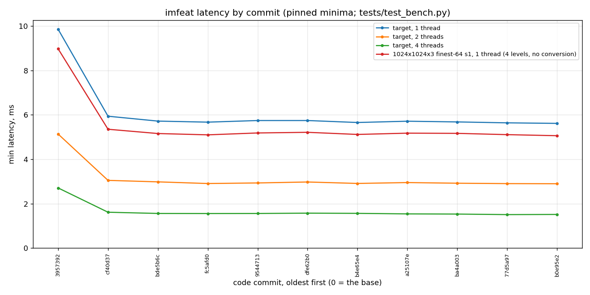
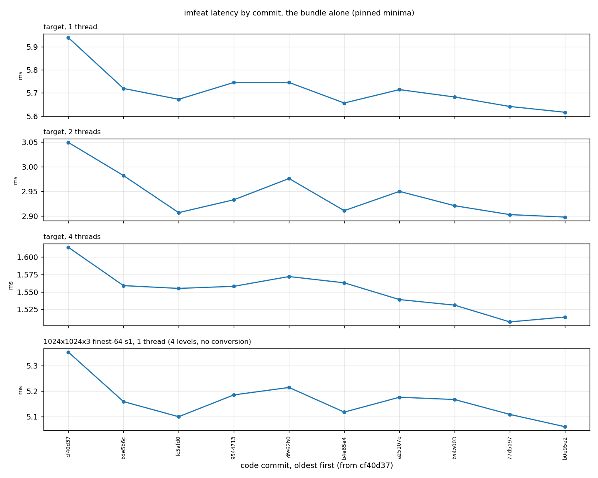

# The October 30 optimisation bundle, commit by commit

This is the record of the second optimisation session on `imfeat`'s core, the branch
`claude/toward-2x-f3c09d` of October 30, 2026, which took the target scenario from the
first bundle's end toward 2× over the original: where it started, where it ended, what every
code commit bought as measured by the benchmark suite in one sitting, what was tried and
dropped, and what the session says about where the remaining time is. It is the sequel of
[oct-28-2026-optimization-bundle.md](oct-28-2026-optimization-bundle.md) (the first bundle,
steps 10–27 of the engineering log) and the companion of [OPTIMIZATION.md](OPTIMIZATION.md),
the engineering log, which has the mechanism of every step and every reverted idea in
detail. Read this one first, that one for the how.

## 1. Scope: the starting and ending commits

| | commit | date | what it is |
|---|---|---|---|
| original | `3957392` | 2026-10-28 | `main` at *Add AGENTS.md*: the code before either bundle. Every "original" number and every × below is this commit, rebuilt and timed in the same sitting as the rest |
| start | `cf40d37` | 2026-10-29 | step 27, the first bundle's last code change; its checkpoint report `b6f55fb` followed the same day with no change to the core |
| last code change | `b0e95e2` | 2026-10-30 | step 36, *HOG: the energy short of each ray by mask, and no side sum* |
| end | the commit that adds this file | 2026-10-30 | this report, its sweep, and the measurement tools added on the way |

Between the start and the end: 9 commits that change `src/imfeat/core.cpp` (the log's steps
28–36, one commit each), 2 that add measurement tools under `scripts/measure/` (the target
profile's scripts; the pipe probes and the order search), and some 30 that change only the
log: every idea tried and reverted has its own entry in its own commit, and every round of
looking has an account. The log's step 28 opened with a per-loop profile of the target
scenario itself, which the first bundle had never profiled (it had profiled the headline
and a 1080p gate frame), and most of this bundle's steps came from it.

The constraints held throughout, as before: every output bit-identical to the original on
the GCC/AVX2, clang and SSE4-only builds (a harness of 40,164 arrays over shapes, grids,
strides, threads, the fused conversion and thumbnails), identical across 1 to 6 threads, no
approximation, nothing tuned to one machine (Highway's portable operations only). Nothing
output-changing was kept; the one candidate of the first bundle, the band-independent
summary, stayed reverted.

## 2. How the numbers were taken

* **The suite and the script are the first bundle's**, unchanged: `pytest -m bench -s
  tests/test_bench.py` of this checkout, run against each commit's build by
  `scripts/latency_by_commit.py`, which exports each commit, builds it, assembles a package,
  pins the suite to idle physical cores and keeps one log per commit. Section 2 of the first
  report describes the suite's rows, the machine and the statistic (the **minimum** over
  the timed calls; everything else is the run's noise). The script gained one option here,
  `--include`, to time the original base in the same sitting as a later bundle's commits.
* **Eleven builds in one sitting.** The original `3957392`, the start `cf40d37` and the
  nine code commits of this bundle, built and timed one after another, so that the ratios
  below compare numbers taken within an hour and a half of each other on the same cores.
  The first report's rows 27–34 were the same commits timed on a busier day by three runs
  resumed over them alone; this table supersedes them.
* **Three runs, the minimum kept**, as before: the suite in full twice, pinned to cores 5,
  6, 7 and 3 (the busiest core of each complex avoided: another job held core 4 and part of
  core 2 all day), and the target scenario alone a third time pinned inside one complex
  (cores 4–7), since a frame whose threads straddle the two complexes reads 20–30% slower
  at two and four threads (lesson 10 of the first report).
* **The log's numbers are a different sitting.** The engineering log's "where the target
  stands" paragraphs give 5.58 / 2.85 / 1.485 ms at 1 / 2 / 4 threads after step 36 and
  call it 1.76× / 1.78× / 1.82× over "the original build in the same session", that build
  having read 9.82 / 5.07 / 2.70 ms there (100 frames, A/B/B/A, cores 4–7). Section 3 says
  what the same two commits read in this sitting, and lesson 6 what to make of a ratio.

## 3. The target scenario across the bundle



The original sets the axis, and a bundle of steps of a percent or two is a flat line on it;
the same series from the start on, each on its own axis:



Minimum latency in ms of the target scenario at 1, 2 and 4 threads, and of the suite's
1024×1024×3 finest-64 stride-1 headline (four levels, no conversion, one thread), at the
original, at the start and after every code commit of this bundle, oldest first. Each number
is the minimum over the three runs of section 2; the runs on their own are
[run 1](oct-30-2026-optimization-bundle/latency_by_commit_run1.md),
[run 2](oct-30-2026-optimization-bundle/latency_by_commit_run2.md) and the
[single-complex target run](oct-30-2026-optimization-bundle/latency_by_commit_ccx.md); the
minimum of every latency the suite prints, one row per number and one column per commit,
is in [latency_by_commit.csv](oct-30-2026-optimization-bundle/latency_by_commit.csv).

| # | commit | target, 1 thread | target, 2 threads | target, 4 threads | headline, 1 thread | change |
|---|---|---|---|---|---|---|
| 00 | `3957392` | 9.855 | 5.135 | 2.708 | 8.974 | Add AGENTS.md |
| 01 | `cf40d37` | 5.939 | 3.049 | 1.614 | 5.352 | LBP ring: the neighbour test as a saturating subtract compared with zero |
| 02 | `bde5b6c` | 5.719 | 2.982 | 1.559 | 5.159 | Two-cell blocks widen in-lane; their int32 kinds fold from the 128-bit halves |
| 03 | `fc5afd0` | 5.672 | 2.907 | 1.555 | 5.100 | HSV row: the >> 12 and the lane merges folded into the float path |
| 04 | `9544713` | 5.745 | 2.933 | 1.558 | 5.185 | Per-block bookkeeping: the group modulo as a mask; the bar detector's run bounds once per chunk |
| 05 | `dfe62b0` | 5.745 | 2.976 | 1.572 | 5.214 | HSV row: one reciprocal carries HNUM, so hdiv's guess is one multiply |
| 06 | `b4e65e4` | 5.656 | 2.911 | 1.563 | 5.118 | LBP phase: one loop down the rows, the nibbles emptied on the way |
| 07 | `a25107e` | 5.714 | 2.950 | 1.539 | 5.176 | The coarser levels rolled up in the bands, a vector of the stripe at a time |
| 08 | `ba4a003` | 5.682 | 2.921 | 1.531 | 5.167 | The hashes derived on the summary job's least-loaded thread |
| 09 | `77d5a97` | 5.641 | 2.903 | 1.507 | 5.109 | HOG: one set of accumulators through a sub-chunk's four quarters where the lanes allow it |
| 10 | `b0e95e2` | 5.616 | 2.898 | 1.514 | 5.061 | HOG: the energy short of each ray by mask, and no side sum |

The same, as speed-ups against the original (row 00), and in the last column the step's own
effect against the commit before it on the target at one thread:

| # | commit | target, 1 thread | target, 2 threads | target, 4 threads | headline, 1 thread | step at 1 thread | change |
|---|---|---|---|---|---|---|---|
| 00 | `3957392` | 1.00× | 1.00× | 1.00× | 1.00× |  | Add AGENTS.md |
| 01 | `cf40d37` | 1.66× | 1.68× | 1.68× | 1.68× | -39.7% | LBP ring: the neighbour test as a saturating subtract compared with zero |
| 02 | `bde5b6c` | 1.72× | 1.72× | 1.74× | 1.74× | -3.7% | Two-cell blocks widen in-lane; their int32 kinds fold from the 128-bit halves |
| 03 | `fc5afd0` | 1.74× | 1.77× | 1.74× | 1.76× | -0.8% | HSV row: the >> 12 and the lane merges folded into the float path |
| 04 | `9544713` | 1.72× | 1.75× | 1.74× | 1.73× | +1.3% | Per-block bookkeeping: the group modulo as a mask; the bar detector's run bounds once per chunk |
| 05 | `dfe62b0` | 1.72× | 1.73× | 1.72× | 1.72× | +0.0% | HSV row: one reciprocal carries HNUM, so hdiv's guess is one multiply |
| 06 | `b4e65e4` | 1.74× | 1.76× | 1.73× | 1.75× | -1.5% | LBP phase: one loop down the rows, the nibbles emptied on the way |
| 07 | `a25107e` | 1.72× | 1.74× | 1.76× | 1.73× | +1.0% | The coarser levels rolled up in the bands, a vector of the stripe at a time |
| 08 | `ba4a003` | 1.73× | 1.76× | 1.77× | 1.74× | -0.6% | The hashes derived on the summary job's least-loaded thread |
| 09 | `77d5a97` | 1.75× | 1.77× | 1.80× | 1.76× | -0.7% | HOG: one set of accumulators through a sub-chunk's four quarters where the lanes allow it |
| 10 | `b0e95e2` | 1.75× | 1.77× | 1.79× | 1.77× | -0.4% | HOG: the energy short of each ray by mask, and no side sum |

Over the bundle, the target went from 5.939 / 3.049 / 1.614 ms at the start to 5.616 / 2.898 / 1.514 at the end at 1 / 2 / 4 threads (−5.4% / −5.0% / −6.2%), and against the original timed in the same sitting, 9.855 / 5.135 / 2.708 ms, the end is 1.75× / 1.77× / 1.79×. The suite's headline (four levels, no conversion) went 5.352 → 5.061 ms, 1.77× the original.
Commit by commit the lines are not monotone: steps 30 and 33 read +1.3% and +1.0% at one
thread here, and the log took both on other evidence (step 30 on executed divider counts and
the samples outside loops, 0.3%; step 33 on the four-thread frame, where it reads −1.0%
below), while the three steps the log measured at −1% or better at one thread (28, 32, 35)
are the three visible drops. Below 2% a single commit's wall clock on this host is placement
and load (lesson 5 of the first report); the bundle's total, −5.4% / −5.0% / −6.2%, is what
the sweep resolves.

## 4. What worked: the committed changes

One line per code commit, in order; the engineering log has each one's mechanism under its
step number. The effect column is the log's own measurement at the time (pinned A/B/B/A
minima at the target, or loop cycle samples and instruction counts where the wall clock
could not resolve the item); the sweep's numbers for the same commit are in section 3.

| # | commit | step | the change | effect as measured in the log |
|---|---|---|---|---|
| 02 | `bde5b6c` | 28 | Two-cell blocks (the target's 16 px cells) widen their row responses in-lane, and their int32 kinds fold from the 128-bit halves of the vectors, each half one cell | the target −3.3% / −4.6% / −3.0% at 1 / 2 / 4 threads; the responses loop 4059 → 2127 cycle samples |
| 03 | `fc5afd0` | 29 | HSV row: the `>> 12` as a floor in the float path, the odd lanes 2¹⁶ higher so the merge into 16-bit lanes is one blend | 176 instructions per 32 pixels from 181; the HSV loop −5% in two runs; the target −0.7% / −0.9% at one thread |
| 04 | `9544713` | 30 | `cell % group` (an integer divide per block) as a mask; the bar detector's run bounds once per chunk | 2,048 `divq` a frame gone, 0.3% by the samples outside loops; 122 K instructions a frame fewer |
| 05 | `dfe62b0` | 31 | HSV row: the shared reciprocal carries HNUM, so hdiv's guess is one multiply | 172 instructions per 32 pixels; the HSV loop's share 9.8% → 9.45% of the module in two runs |
| 06 | `b4e65e4` | 32 | LBP phase as one loop down the rows, the nibbles emptied every 15 rows on the way instead of a second pass for a 16-row chunk's last row | 225 K instructions a frame fewer; the target −1.1% / −1.0% at one thread |
| 07 | `a25107e` | 33 | The coarser levels rolled up inside the derive job by the bands (every level whose rows split evenly across them), the rest serially after | 35 µs of serial roll-up spread over the bands: −1.2% at four threads, neutral at two and one |
| 08 | `ba4a003` | 34 | The hashes derived by the summary job's least-loaded thread while the others fold | with step 33: −2.3% / −2.1% at four threads, −0.6% / −1.0% at two, +0.4% (placement) at one |
| 09 | `77d5a97` | 35 | HOG: one set of accumulators through a sub-chunk's four quarters where every lane of a vector is the same cell (one- and two-cell blocks), the Acc holding it once, the folds reading it | −1.2% twice at one thread, −1.0% / −1.3% at four; the straight-line code −1,600 samples, the moments loop −11%, against the energy and responses loops +7% / +16%; instructions +1% |
| 10 | `b0e95e2` | 36 | HOG: the energy short of each ray taken by a mask (the ray test's sign bit, a shift and an AND on the pipes the multiplies leave free) and the same by side, so the side sum cancels out of the flush: eight accumulators instead of nine, one sign flip a row instead of nine | the HOG loop −13% of its cycle samples in two runs; the target −0.3% / −0.2% at one thread, −0.1% at two, −0.7% at four |

Where the time went at the target after step 36, by phase timers in a scratch copy of the
source (the log's "Looked at after step 36" account): per sampled row of a single-thread
frame, 143 ticks in the kernel, of which the LBP ring 24, the bar detector 19, the row
responses 10, the energies 29, the moments 14, the HOG quarter loop 43 and the code between
phases 4; every loop within 5% of the speed its body runs on an L1 buffer. Outside the
kernel: the HSV row loop about 12% of the frame, the folds 6%, derive 4%, the summary 3%,
the roll-up 2%, a fixed 27 µs per call. Parallel efficiency about 93% at four threads, the
tail being the summary job's cross-core reads, which the contract fixes.

## 5. What did not work

Everything below was built, verified bit-exact where it got that far, measured and
reverted; each has a paragraph in the engineering log ("Tried after step N", "Looked at
after step N"), and the two that mattered most for understanding have tools in
`scripts/measure/micro`. Grouped by what the attempt assumed.

**Moving a phase out of the kernel function to give its loop the registers.** The bar
detector had gained from this in the first bundle (step 15). Here the HOG phase as a
function of its own cost +3%, the stride-1 energy corrections +3.6%, the responses loop with
one running pointer per table +1.4%, the HOG and energy halves sharing one accumulator set
+1.5%: `block()` is one function with every phase inlined, and GCC's allocation of it is
what each loop gets. Step 35, the one allocation change kept, merged accumulators only
where the lanes allowed it and paid for itself on the straight-line code around the loops.

**Two rows an iteration, or one.** The HOG quarter loop over two rows (+1.7%), the
responses loop over two (worse), the moments loop's two rows loaded together (no change),
the moments loop one row an iteration (−12% on an L1 copy, +10% in the kernel), the bar
detector moved between the responses and the energies (+2–4%). Each either spilled in the
kernel or found no latency to hide: the loops are issue-bound, not latency-bound.

**Caching less or widening elsewhere.** The responses pass without its stored pixel row,
the moments loop widening the bytes itself on the idle shuffle pipes: −20% on the responses
body alone, +5% in the kernel (the moments loop +40% of its samples, seven more spills in
the LBP ring). The responses loop's invariants hoisted into locals: the loop −9%, the frame
+1.2%. The derive group of sixteen cells: neutral. The derive job folded into the bands'
tails: mixed, neutral.

**Operation substitutions by pipe.** With the per-instruction pipe table of this core in
hand (the first bundle's lesson, extended here to every instruction the kernel uses), the
substitutions that keep the count and move an operation to an idle pipe were tried one by
one: the LBP ring's test as a biased signed compare (neutral), the HOG's fourth power as
two double FMAs (slower alone), the HSV conversion's four lane groups through the float
stages in step (the loop −7.5%, the frame neutral), the HOG's sign flips as masks (step 36:
the one that won, −13% on its loop). After step 36 no loop has an operation on a pipe
another instruction of equal count would avoid.

**Steering the compiler's schedule.** The LBP ring's neighbour tests pinned in order by an
empty asm (−9% on the L1 copy, +13% in the kernel: GCC spilled differently, not less), its
five vote tables as byte shifts of one to free registers (the counters stayed in memory,
+2%), the HOG's fourth power moved after the ray tests in the source (−1% on the loop,
noise). An order search of the HOG body as inline asm found orders 8% faster than the
kernel's and orders 65% slower, and no way to ask for one from portable source.

**Compilers and flags.** `-O2` in place of `-O3` (+29%: GCC 11 stops unrolling the ray
loop), `-mrecip=vec-div` (+4.5%), `-falign-loops=64` (+1.6%), link-time optimisation
(+0.5%), no-PLT (neutral), `-fomit-frame-pointer` (a byte-identical module: the frame
pointer is the AVX stack realignment), the first scheduling pass with register pressure
(no change, from the first bundle), a newer GCC (not installable on this host).

**Per-pixel algebra, re-costed and left.** The log's entry "The 2× question after step 34"
costs every reformulation of the per-pixel work that would cut operations: the HOG's ray
tests two pixels per multiply, the moment sums as a sector scatter, the LBP code packed,
a biased plane, the HSV conversion by table identities. Each lands at or above the count
of what it would replace. The kernel's instruction mix is the computation's; 2× from here
means computing something else.

**Outside the kernel, measured and closed.** The fixed cost per call (27 µs: the binding,
24 numpy views, the hash's DCT), a dispatch (3 µs), the output block's reuse (no page
faults), the frame's DRAM traffic (300 KB), the TLB (0.3% in-module), the prefetcher (no
loop waits on L1), the store-to-load interlocks, the branch mispredictions (25 K a frame,
the loop exits), the op cache (a quarter of the ops from the decoder, and `-O2` the wrong
cure). None above half a percent.

## 6. Trends and lessons

What the bundle as a whole says, for whoever picks this up (the engineering log's lessons
14 and 15 are the per-step versions; the first report's lessons 1–10 still hold).

1. **Profile the target itself.** The first bundle's profiles were of the headline (one cell
   a block) and a 1080p gate frame; the target is two cells a block and 16-row chunks, and
   its own per-loop profile found the row responses widening through an instruction
   confined to one-cell blocks (step 28, −3.3%), the LBP's outer pass running twice (step
   32, −1.1%) and an integer divide per block (step 30). Four of this bundle's nine steps
   were below the wall clock's resolution and were taken on their loop samples and
   instruction counts.
2. **Measure a loop's body apart from the kernel before blaming the kernel.** A copy of the
   loop body on an L1-resident buffer (`scripts/measure/micro/`) says in a minute what the
   body costs on its own, and the per-instruction pipe table turns an instruction count
   into a floor. The HOG loop's cycles are all its own; the responses loop's apparent gap
   to its copy was an accounting error (the next lesson).
3. **Settle where the time goes with timers before samples.** Cycle samples per loop,
   divided by the wrong row count, made the responses loop look twice as slow in the kernel
   as alone, and a round went after surroundings that were not there. One scratch build
   with a cycle counter around each phase gave every phase's cycles per row directly and
   showed every loop at its L1-copy speed.
4. **An L1 copy's gain is not the kernel's.** Six variants of this bundle won on their
   loop body alone and lost in the kernel, every one to GCC's allocation of `block()`:
   spills, reloads, a differently hoisted load. The copy answers "what does this body
   cost", never "what will the kernel do with it"; only the build and the per-loop samples
   answer that.
5. **The pipes set the floor; the dispatcher decides the rest, and only the order reaches
   it.** On this core every integer multiply issues on one pipe, every shift on another,
   and multi-pipe operations are assigned at dispatch from the pipes' recent load, so the
   same instructions in another order take 8% fewer or 65% more cycles (the HOG body under
   `scripts/measure/micro/hog_order.py`). The kernel's loops are at 1.25–1.5× their
   four-pipe floors, and the gap belongs to that assignment, which portable source cannot
   choose. This is the end of the single-thread road within the contract.
6. **A ratio to the original is only as steady as the original's own reading.** The
   first report's sweep, on a quiet day, put the original at 9.45 ms and the first
   bundle's end (`cf40d37`) at 5.78: 1.63×, against the 1.75× the log had claimed from
   its own sessions, where the original read 9.8. This sweep, on a day with another job
   on the box, reads the same `cf40d37` at 5.94 and the original at 9.86: 1.66×, and this
   bundle's end at 5.62: 1.75×, which happens to match the log's 1.76× because the
   original read 9.82 in the log's sessions too. So the optimised builds move by 2–3%
   between sittings and the original by 4–5%, the more the busier the machine, it being
   the memory-heavier of the two; the end of this bundle is 1.75× on a loaded day and would
   be about 1.68× against the quiet day's original. The number that survives a change of
   day is the bundle's own gain, start to end in one sitting (−5.4% / −5.0% / −6.2% here);
   quote a ratio only with both sides timed together and the day's load said.
7. **Small exact steps add up, and so do their costs.** Nine steps of 0.3–3.3% each took
   the target from the start's 5.939 to 5.616 ms at one thread (−5.4%),
   1.614 to 1.514 at four (−6.2%); about 30 reverted ideas, each built
   and verified, were the price of finding them. The log's reverted entries are the map of
   where not to go again.
8. **The multi-thread tail is at the contract's limit.** Two steps (33, 34) moved serial
   work into the bands and took the four-thread frame down 3.5%; what is left is the
   summary job's reads of per-cell records other cores wrote, which only the
   output-changing band-independent summary removes. The first report's lesson 4 stands.

## 7. Reproducing the table on another machine

From a checkout of this branch, with the build prerequisites of the README:

```bash
python scripts/latency_by_commit.py sweep --include 3957392 --base cf40d37 --head HEAD \
    --out docs/oct-30-2026-optimization-bundle --cores 5,6,7,3
```

builds and benchmarks the original, the start and every code commit of the bundle into
`docs/oct-30-2026-optimization-bundle/` (about 2.5 minutes per commit on this host, nearly
all of it the suite), and

```bash
python scripts/latency_by_commit.py report --out docs/oct-30-2026-optimization-bundle \
    --tag ",_run2,_ccx"
```

writes the CSV, the Markdown table and the chart as the minimum per number over the three
runs. `--tag _run2` names the second full run's logs, and `--k target_pyramid --tag _ccx
--cores 4,5,6,7` runs only the target scenario on the packages already built, pinned
inside one core complex; `--resume` skips commits whose log exists. The sweep refuses to
time a module byte-identical to the previous commit's. To compare just two builds by hand,
`pytest -m bench -s tests/test_bench.py -k target_pyramid` with `PYTHONPATH` pointing at a
built package is the whole measurement.

See [OPTIMIZATION.md](OPTIMIZATION.md) for the mechanism of every step, the measurement
tools in detail, the verification harness and the list of what was looked at and closed.
